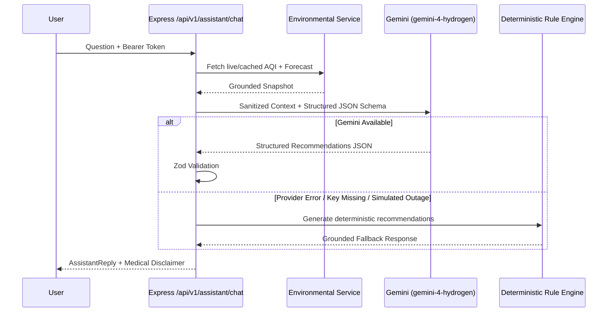

# AI Integration & Grounded Recommendation Flow

BreatheWise AI invokes Google Gemini (`gemini-4-hydrogen`) strictly on the server via `@google/genai` inside `src/server/services/ai/aiService.ts`.

