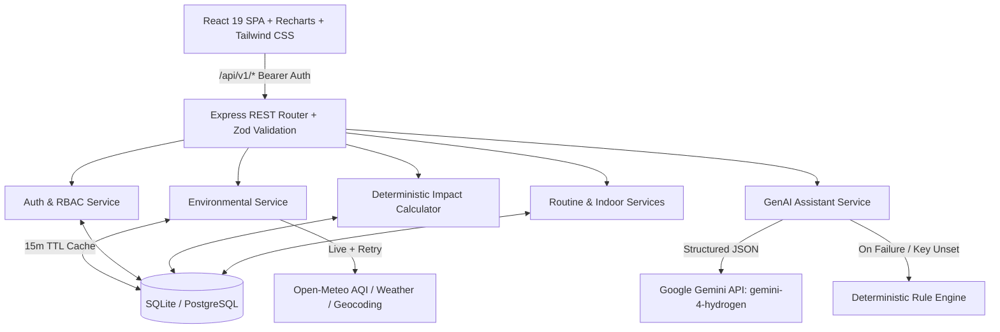

# System Architecture

BreatheWise AI follows a modular, layered architecture separating presentation, authentication, API validation, deterministic environmental engines, AI orchestration, and persistence.

## Module Responsibilities

- `src/server/routes/api.ts`: Composes the versioned `/api/v1` REST API from modular domain routers (`authRoutes.ts`, `environmentRoutes.ts`, `assistantRoutes.ts`, `impactRoutes.ts`, `communityRoutes.ts`, `engagementRoutes.ts`, `adminRoutes.ts`) and shared validation helpers (`helpers.ts`).
- `src/server/services/air-quality/`: Explicit US EPA vs. India NAQI breakpoint math (`aqiStandards.ts`) and Open-Meteo fetching/caching (`environmentalService.ts`).
- `src/server/services/ai/`: Gemini SDK wrapper with prompt-injection neutralization and deterministic fallback (`aiService.ts`).
- `src/server/services/emissions/`: Deterministic emissions-factor calculations and duplicate-activity guards (`impactCalculator.ts`).
- `src/server/services/routines/`, `indoor/`, `alternatives/`, `notifications/`: Domain-specific guidance modules.
