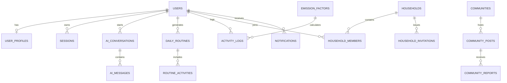

# Database Design & Relationships

BreatheWise AI uses normalized relational tables with foreign keys, unique constraints, and indexes. Local/preview environments run on zero-config embedded SQLite (`src/server/db/database.ts`), while `prisma/schema.prisma` mirrors the exact relational model for PostgreSQL deployments.

