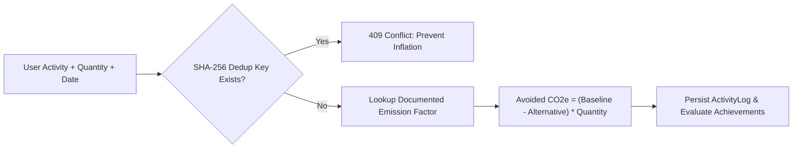

# Environmental Calculations & Emission Factors

All numerical environmental impact values are calculated deterministically in `src/server/services/emissions/impactCalculator.ts`.

## Scientific Distinctions
- **Personal Exposure Reduction** (e.g., shifting exercise indoors or using an N95 mask) protects lungs immediately.
- **Local Tailpipe / Smoke Reduction** (e.g., stopping vehicle idling or avoiding open waste burning) lowers neighborhood NO2 and primary PM2.5.
- **Greenhouse Gas Avoidance (CO2e)** reflects cumulative climate impact and does **not** measurably drop citywide ambient AQI on its own.
